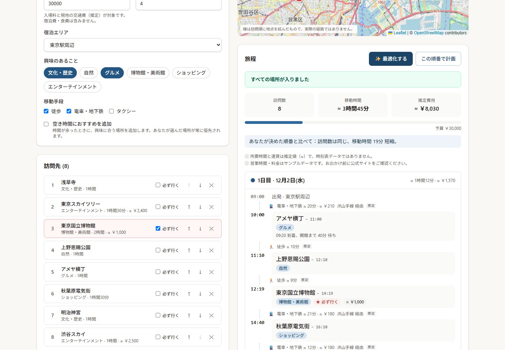
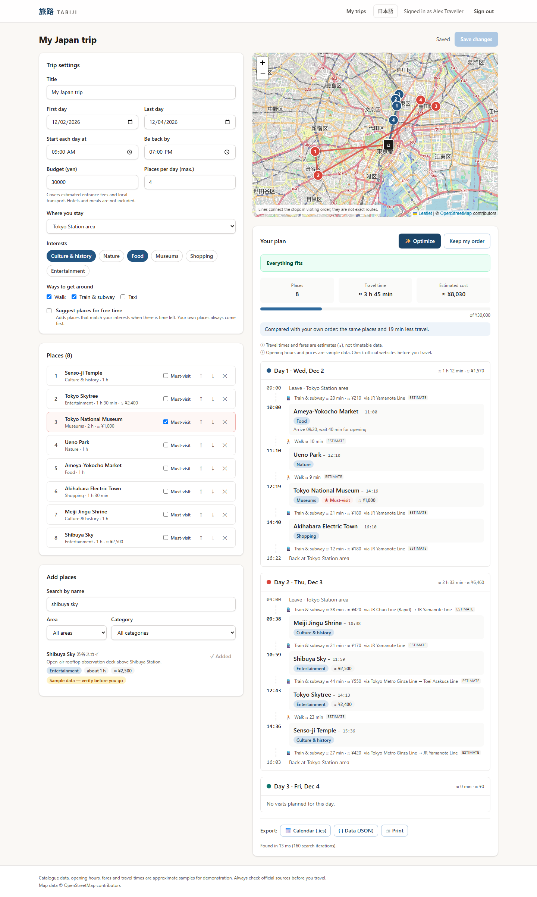
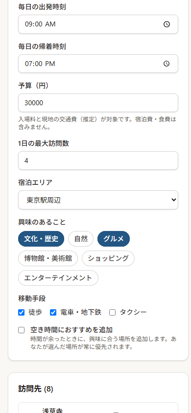
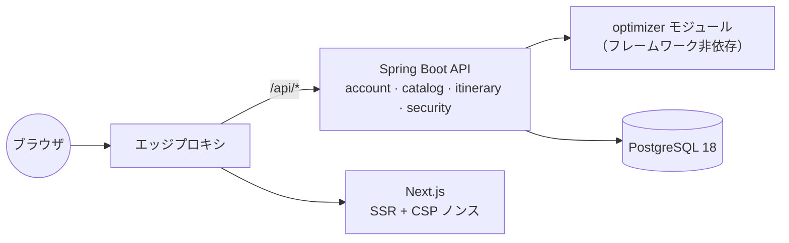

# Tabiji 旅路 — 日本旅行インテリジェント・プランナー

[English README](README.md)

行きたい場所、日程、1日の行動時間、予算（円）、興味、移動手段を指定すると、**最適化された説明可能な旅程**
を作成する Web アプリケーションです。どの場所を何日目の何時に、どの順番で訪れるか、移動時間と運賃の見積もり、
そして入りきらなかった場所にはその理由まで示します。画面は日本語と英語に対応しています。

旅程を作るのは AI の文章生成ではなく、**本物の最適化エンジン**です。時間枠付きチームオリエンテーリング問題
（TOPTW）に対する決定的な反復局所探索（Iterated Local Search）を実装し、厳密解法と比較して検証しています。
動かす・デモするのに有料サービスや API キーは一切不要です。



| English UI | スマートフォン |
| --- | --- |
|  |  |

> 施設カタログ、営業時間、運賃、鉄道ネットワークはデモ用の**サンプルデータ**です。画面上ではすべて
> 「サンプルデータ」または「見積もり」と表示し、公式の時刻表や料金として扱うことはありません。

## 特長

- **説明できる最適化。** 辞書式の目的関数（必須の場所 → 自分で選んだ場所 → 移動時間の短さ → 費用の安さ）、
  美術館・博物館の祝日ルール、昼休みを含む営業時間、1日の訪問数の上限、旅行全体の予算に対応。
  ランダムな小規模問題 1,000 件で**95.8 %** が厳密な最適解と同じ目的関数値になり、制約違反の旅程は **0 件**
  でした。利用者が並べた順番どおりの計画と比べると、訪問できる場所が 44〜75 % 増え、1か所あたりの移動時間が
  18〜36 % 減ります（[ベンチマーク](docs/benchmarks.md)）。
- **設計段階からのセキュリティ。** `__Host-` Cookie によるサーバーサイドセッションと CSRF トークン、全エンドポイントで
  テストしているオブジェクトレベル認可（他人の旅程は常に 404）、Argon2id、レート制限、厳格なセキュリティヘッダーと
  ノンス方式の CSP、マスアサインメント対策、内部情報を含まない RFC 9457 形式のエラー。各対策と実装・テストの対応は
  [セキュリティ対策](docs/security-controls.md)にまとめています。
- **本物のインフラでのテスト。** インメモリの代用品ではなく実際の PostgreSQL 18 上で動くバックエンドテスト 157 件、
  フロントエンド単体テスト 43 件、アクセシビリティ検査付きの Playwright シナリオ 5 件。SpotBugs + FindSecBugs の
  指摘 0 件、最適化モジュールの行カバレッジ 95 %（[テスト戦略](docs/testing-strategy.md)）。
- **最初の画面から日英対応。** `/ja` と `/en` のルーティング、英語版と型で整合性を検査する日本語メッセージ、
  円・日付・所要時間の表記やカレンダー出力も言語に合わせて切り替えます。
- **フロントとバックで共有する API 契約。** OpenAPI 定義をコードから生成してリポジトリに含め、テストで差分を検出。
  フロントエンドの TypeScript 型も同じ定義から生成しています。

## 機能

- エリア・カテゴリ・名前（日本語・英語）で場所を検索し、追加・削除・並べ替え、必須指定。
- 旅行の設定：日程（最大14日）、1日の開始・終了時刻、1日の訪問数、予算（円）、興味、宿泊エリア、
  移動手段（徒歩・電車・タクシー）、空き時間へのおすすめ追加。
- **最適化**と**自分の順番どおり**の2つの計画方法と、その比較。
- 日ごとのタイムライン：出発、移動（手段・所要時間・運賃・路線）、待ち時間、滞在、帰着。見積もりはすべて明示。
  入らなかった場所には具体的な理由と改善のヒント。
- インタラクティブな地図（Leaflet + OpenStreetMap）に日ごとの番号付きマーカー。
- 保存、編集（別タブでの同時編集を検出）、複製、削除。計画後に編集すると「古い計画」と表示。
- カレンダー（`.ics`、表示中の言語）と JSON への出力、印刷用ページ。
- アクセシビリティに配慮したレスポンシブ UI。空・読み込み中・エラーの各状態を用意。

## 起動方法

### Docker なし — JDK 21 と Node.js 24

PostgreSQL のインストールは不要です。開発用ランチャーが PostgreSQL 18 のバイナリを自動で起動します
（Docker があればコンテナを使います）。

```bash
cd backend
./mvnw -pl app -am install -DskipTests   # 初回のみ（Windows は mvnw.cmd）
./mvnw -pl app spring-boot:test-run      # API: http://localhost:8080 、Swagger UI: /swagger-ui.html
```

```bash
cd frontend
npm ci
npm run dev                              # http://localhost:3000
```

画面からアカウントを登録してください。API 起動前に `TABIJI_DEMO_PASSWORD` を設定すると、サンプル旅程付きの
`demo@tabiji.example` が作成されます（12〜128 文字、"demo" を含まないこと）。

### Docker Compose

```bash
cp .env.example .env                     # POSTGRES_PASSWORD を設定（例: openssl rand -hex 24）
docker compose up --build --wait         # http://localhost:3000
```

PostgreSQL・API・Web・エッジプロキシ（Caddy）の構成で、外部に公開するのは `127.0.0.1` 上のエッジだけです。
本番環境のチェックリストと設定項目は [docs/deployment.md](docs/deployment.md) を参照してください。

### 品質チェック

```bash
cd backend && ./mvnw verify              # テスト、Spotless、SpotBugs、カバレッジ基準
cd frontend && npm run verify            # Prettier、ESLint、tsc、Vitest、本番ビルド
cd frontend && npx playwright test       # 起動中のアプリに対して実行（docs/testing-strategy.md）
```

## 技術スタック

| 層 | 技術 |
| --- | --- |
| フロントエンド | Next.js 16.4（App Router）、React 19.3、TypeScript 5.9（strict）、Tailwind CSS 4.3、TanStack Query 5、openapi-fetch、Leaflet 1.9 / react-leaflet 5 |
| バックエンド | Java 21 LTS、Spring Boot 4.1（Spring Framework 7、Spring Security 7、Hibernate 7、Jackson 3）、springdoc-openapi、Bucket4j + Caffeine |
| 最適化エンジン | フレームワーク非依存の Java 21（ArchUnit で強制） |
| データ | PostgreSQL 18、Flyway 12 |
| テスト | JUnit 6（Jupiter）、AssertJ、Mockito、Testcontainers / 組み込み PostgreSQL、ArchUnit、JMH、Vitest + Testing Library、Playwright + axe-core |
| 品質・セキュリティ | Spotless、SpotBugs + FindSecBugs、JaCoCo、ESLint、Prettier、CodeQL、OSV-Scanner、npm audit、gitleaks、Dependabot、CycloneDX SBOM |
| デリバリー | Docker（マルチステージ、非 root、ダイジェスト固定）、Docker Compose、GitHub Actions（コミット SHA 固定） |

## アーキテクチャ



モジュラーモノリス構成です。API は機能単位（`api` → `application` → `domain` ← `infrastructure`）で整理し、
最適化エンジンは小さなインターフェースの背後にあるフレームワーク非依存のモジュール、フロントエンドは同一
オリジン経由で API と通信します。移動データの提供元は差し替え可能なポートで、サンプル鉄道網はその実装の1つです。
詳細：[アーキテクチャ](docs/architecture.md)・[データベースと ER 図](docs/database.md)・[API](docs/api.md)・
[ADR](docs/adr/README.md)

## 最適化の仕組み（概要）

1. 旅行日ごとの営業時間を求めます。臨時休業や「月曜休館（祝日の場合は翌平日休館）」のルールも反映します。
2. 移動時間の行列を作ります。電車は路線展開グラフ上のダイクストラ法、徒歩とタクシーは距離モデルで見積もり、
   一般化費用（移動時間1分＝30円換算）で手段を選びます。
3. どうしても訪問できない場所は、具体的な理由を付けて除外します。
4. 難しい必須地点から順に配置し、時間と予算あたりの価値が高い場所を加えて初期解を作ります。シード固定の
   反復局所探索の中で、挿入・置換・2-opt・or-opt・日をまたぐ移動・交換による局所探索で改善し、訪問数の少ない日は
   全順列で並べ直して仕上げます。
5. 結果を独立した検証器で再チェックしてから保存します。

計算量、パラメータ、検証方法、制約事項は [docs/algorithm.md](docs/algorithm.md) にあります（英語）。

## ドキュメント

ドキュメントは英語で書いています。

| ドキュメント | 内容 |
| --- | --- |
| [プロジェクト計画](docs/plan/project-plan.md) | 出発点、MVP、マイルストーン、受け入れ基準とその達成状況 |
| [アーキテクチャ](docs/architecture.md) | 構成要素、モジュール、リクエストの流れ、フロントエンド |
| [データベース](docs/database.md) | ER 図、マイグレーション、設計上の注意点 |
| [API](docs/api.md) | 認証方式、エンドポイント、エラー、制限。[OpenAPI 定義](docs/api/openapi.json) |
| [アルゴリズム](docs/algorithm.md) | 問題のモデル化、探索、移動の見積もり、検証、計算量 |
| [ベンチマーク](docs/benchmarks.md) | 解の品質と実行時間（測定環境と方法つき） |
| [脅威モデル](docs/threat-model.md) | STRIDE 分析、対策の状況、残存リスク |
| [セキュリティ対策](docs/security-controls.md) | OWASP Top 10 → 実装 → テスト |
| [テスト戦略](docs/testing-strategy.md) | テストの種類、カバレッジ、静的解析、CI |
| [デプロイ](docs/deployment.md) | ローカル起動、Compose、本番チェックリスト、設定項目 |
| [既知の制約](docs/known-limitations.md)・[ロードマップ](docs/roadmap.md) | 足りないものと今後の予定 |
| [デモ手順](docs/demo.md) | 面接向けの10分間ウォークスルー |
| [ADR](docs/adr/README.md) | 10 件のアーキテクチャ決定記録 |

## Technical Interview Discussion / 技術面接で説明できるポイント

このプロジェクトで説明できる技術的な判断と、そのトレードオフ、根拠となるコードや資料です。

1. **なぜ「AI」や総当たりではなくメタヒューリスティクスなのか。** 問題は NP 困難で、厳密な全探索は指数時間
   （`O(d·n! + (d+1)^n)`）です。言語モデルは営業時間や予算の厳守を保証できません。反復局所探索はこの問題クラスの
   定番手法で、決定的・計算量の上限あり・結果は毎回再検証されます。→ [algorithm.md](docs/algorithm.md)
2. **最適化の品質をどう確かめたか。** 小規模問題での厳密解法との比較（95.8 % が同じ目的関数値、平均スコア差
   0.18 %）、数百件のランダム旅程に対するプロパティテスト、独立した検証器、そして外れたケースの原因分析。
   → [benchmarks.md](docs/benchmarks.md)
3. **重み付き和ではなく辞書式の目的関数。** 調整すべきマジックナンバーがなく、どの比較も一文で説明できます。
   利用者の希望を表すスコアは、おすすめの場所が利用者自身の選んだ場所を押しのけないことをテストで証明しています。
   → `Objective.java`、`CandidateScoringTest`
4. **事実を作らない。** すべての移動時間と運賃に出典と「見積もり」の表示を付け、鉄道データがない場合は架空の電車を
   作らず「経路なし」と報告します。→ ADR-0007
5. **ブラウザで JWT を持たず、セッションと CSRF を使う理由。** HttpOnly の `__Host-` Cookie、ログイン時の
   セッション ID 再発行、ダブルサブミット方式の CSRF 対策。JavaScript からトークンに触れられません。
   → ADR-0003、`AuthFlowIT`
6. **BOLA/IDOR の防止。** 所有者で絞り込む読み込み経路を1つに集約し、他人の ID も存在しない ID も同じ 404 を返します。
   2人目のユーザーとして全エンドポイントを攻撃するテストがあります。→ `ItineraryService.load`、`OwnershipSecurityIT`
7. **フレームワークの実装を読んで見つけたデプロイ上の問題。** Next.js はリライト時に `X-Forwarded-For` をそのまま
   転送するため、直接公開するとクライアントがレート制限上の IP を自由に名乗れます。エッジプロキシを唯一の公開
   入口にすることで解決しました。→ ADR-0010
8. **Docker がなくても毎回実際の PostgreSQL でテスト。** CI では Testcontainers、ノート PC では組み込みバイナリを使い、
   マイグレーションと制約を本番と同じ形で検証します。→ ADR-0005
9. **契約優先の連携。** OpenAPI 定義を生成してコミットし、テストで比較。TypeScript のクライアント型もそこから
   生成します。ステータスコードの記述の修正やログアウトの追加も、このチェックを通して行いました。
   → `OpenApiContractIT`
10. **マイクロサービスではなくモジュラーモノリス。** ArchUnit で強制する明確な境界、デプロイ単位は1つ、分散
    トランザクションなし。最適化エンジンは変更なしで将来サービスに切り出せます。→ ADR-0001
11. **サプライチェーン対策。** インストールスクリプトを無効にしたロックファイル運用、ダイジェスト固定のイメージ、
    SHA 固定の Actions、待機期間付きの Dependabot、CodeQL、OSV-Scanner、gitleaks、SBOM。→ `.github/`
12. **日本向けの配慮。** 祝日を考慮した営業時間ルール、円表記、日本語 UI とカレンダー出力、サンプルデータを
    公式情報のように見せない「サンプルデータ」表示。→ `OpeningHoursResolver`

## 現在の状況と制約

- Docker なしの Windows 11 環境で実装・検証済み：`./mvnw verify` と `npm run verify` が成功し、本番ビルドに対する
  Playwright のシナリオもすべて成功しています。
- **未実行のもの：** Docker イメージ、Compose 構成、GitHub Actions ワークフロー（開発マシンに Docker がなく、
  リポジトリもまだ push していないため）。CI の `e2e` ジョブが実行されれば、Compose 構成をビルドしてテストします。
- データはサンプルのみ、結果はヒューリスティックによるもの、API は単一インスタンス構成です。詳しくは
  [既知の制約](docs/known-limitations.md)と[ロードマップ](docs/roadmap.md)を参照してください。

## ライセンス

[MIT ライセンス](LICENSE)（© 2026 coderremarks）。スクリーンショット内の地図画像は © OpenStreetMap contributors
（<https://www.openstreetmap.org/copyright>）です。施設カタログはデモ用のサンプルデータであり、公式の情報源ではありません。
