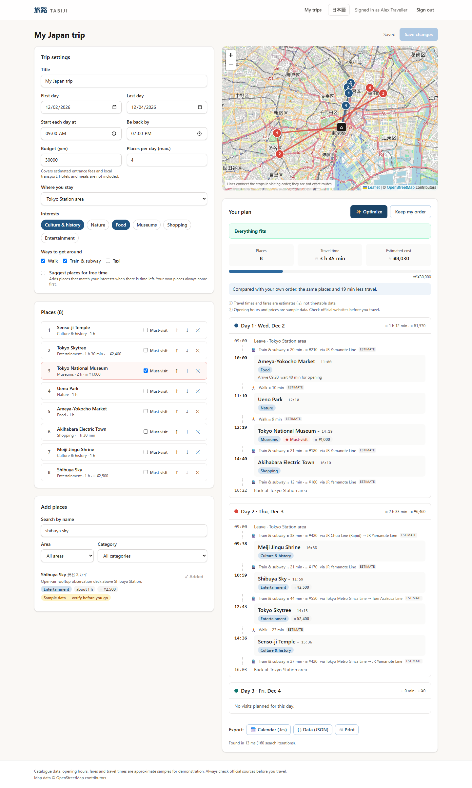
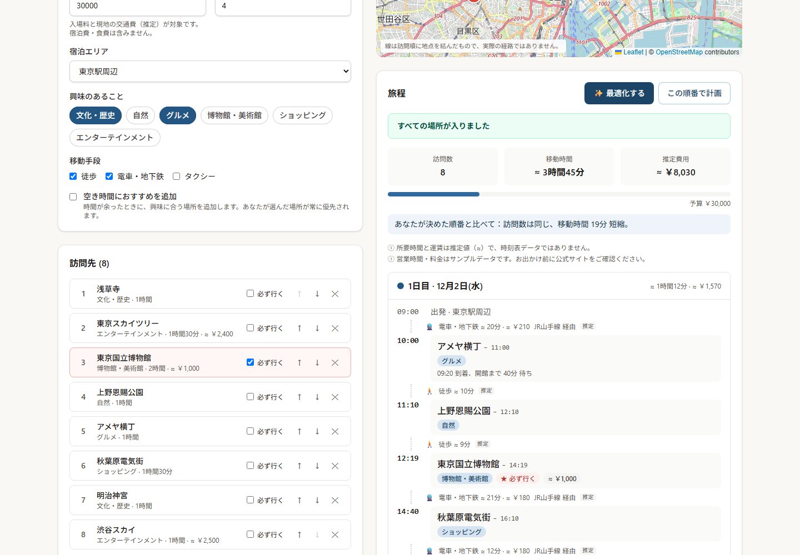
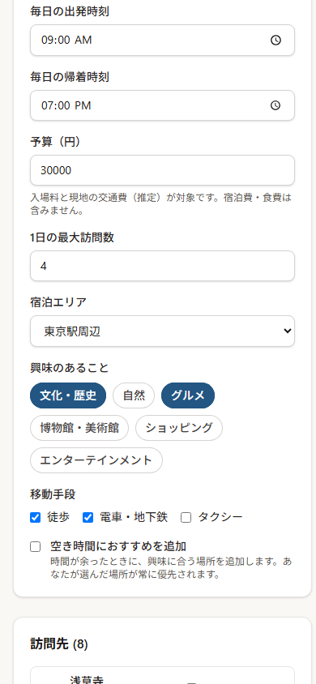
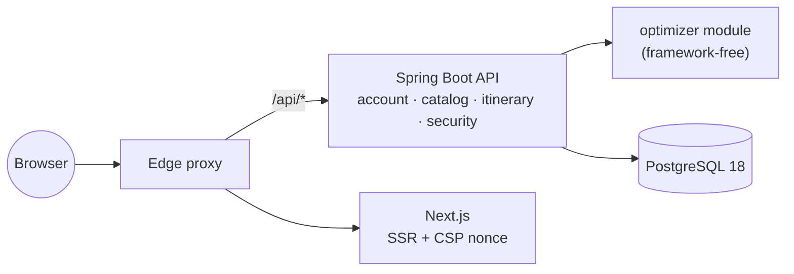

# Tabiji 旅路 — Japan Intelligent Travel Planner

[日本語版 README はこちら](README.ja.md)

Plan a multi-day trip through Japan: pick places, set your dates, daily hours, budget in yen,
interests and travel modes, and get an **optimized, explainable itinerary** — which place on which
day, in which order, at what time, with estimated travel times and fares, and a clear reason for
everything that did not fit. In Japanese and English.

The planner is a **real optimization engine**, not an AI text generator: a deterministic Iterated
Local Search for the Team Orienteering Problem with Time Windows, verified against an exact solver.
No paid service or API key is needed to run or demonstrate it.



*Eight places, at most four a day: everything fits into the first two days (the optimizer does not
yet balance days — see [known limitations](docs/known-limitations.md)).*

| 日本語の画面 | Mobile |
| --- | --- |
|  |  |

> The catalogue, opening hours, fares and the rail network are **sample data** for demonstration.
> Every such value is labelled in the UI as sample data or as an estimate; nothing is presented as an
> official timetable or price.

## Highlights

- **Optimizer you can explain.** A lexicographic objective (must-visits → your places → less travel →
  lower cost), Japanese museum holiday rules, opening hours with lunch breaks, daily limits and a trip
  budget. On 1,000 random small trips the heuristic matched the exact optimum in **95.8 %** of cases
  and produced **0** invalid plans; against the traveller's own order it fits 44–75 % more places with
  18–36 % less travel per place ([benchmarks](docs/benchmarks.md)).
- **Security by design.** Server-side sessions with `__Host-` cookies and CSRF tokens, object-level
  authorisation tested on every endpoint (another user's trip is always a 404), Argon2id, rate limits,
  strict headers and a nonce-based CSP, mass-assignment protection, RFC 9457 errors without internals.
  Every control is mapped to its code and test ([security controls](docs/security-controls.md)).
- **Tested on real infrastructure.** 157 backend tests on real PostgreSQL 18 (no in-memory
  substitute), 43 frontend unit tests and 5 Playwright journeys with accessibility checks; SpotBugs +
  FindSecBugs with 0 findings; 95 % line coverage in the optimizer ([testing](docs/testing-strategy.md)).
- **Bilingual from the first screen.** `/ja` and `/en` routes, a type-checked Japanese catalogue,
  localised yen, dates, durations and calendar exports.
- **One contract for both sides.** The OpenAPI document is generated from the code, committed and
  checked; the frontend's TypeScript client types are generated from it.

## Features

- Search a catalogue of places by area, category and name (Japanese or English); add, remove and
  reorder stops; mark must-visits.
- Trip settings: dates (up to 14 days), daily start and end time, visits per day, budget in yen,
  interests, base location, allowed travel modes (walk, transit, taxi), optional suggestions.
- **Optimize** or **Keep my order**, with a side-by-side comparison of the two.
- Day-by-day timeline: departure, each leg with mode, minutes, fare and lines, waiting time, visits,
  return; every estimate labelled. Unscheduled places with a precise reason and hints what to change.
- Interactive map (Leaflet + OpenStreetMap) with numbered stops per day.
- Save, edit (with conflict detection between tabs), duplicate, delete; stale-plan warning after edits.
- Export to calendar (`.ics`, in the UI language) and JSON; print view.
- Accessible, responsive UI with empty, loading and error states.

## Quick start

### Without Docker — JDK 21 and Node.js 24

PostgreSQL does not have to be installed: the development launcher starts real PostgreSQL 18 binaries
automatically (or a container, if Docker is available).

```bash
cd backend
./mvnw -pl app -am install -DskipTests   # first time only (Windows: mvnw.cmd)
./mvnw -pl app spring-boot:test-run      # API on http://localhost:8080, Swagger UI at /swagger-ui.html
```

```bash
cd frontend
npm ci
npm run dev                              # http://localhost:3000
```

Register an account in the UI, or set `TABIJI_DEMO_PASSWORD` before starting the API to get
`demo@tabiji.example` with a sample trip (12–128 characters, must not contain "demo").

### With Docker Compose

```bash
cp .env.example .env                     # set POSTGRES_PASSWORD, e.g. openssl rand -hex 24
docker compose up --build --wait         # http://localhost:3000
```

The stack runs PostgreSQL, the API, the web app and a Caddy edge proxy; only the edge publishes a port,
on `127.0.0.1`. Details, production checklist and configuration: [docs/deployment.md](docs/deployment.md).

### Checks

```bash
cd backend && ./mvnw verify              # tests, Spotless, SpotBugs, coverage gates
cd frontend && npm run verify            # Prettier, ESLint, tsc, Vitest, production build
cd frontend && npx playwright test       # against a running stack, see docs/testing-strategy.md
```

## Tech stack

| Layer | Technology |
| --- | --- |
| Frontend | Next.js 16.4 (App Router), React 19.3, TypeScript 5.9 (strict), Tailwind CSS 4.3, TanStack Query 5, openapi-fetch, Leaflet 1.9 / react-leaflet 5 |
| Backend | Java 21 LTS, Spring Boot 4.1 (Spring Framework 7, Spring Security 7, Hibernate 7, Jackson 3), springdoc-openapi, Bucket4j + Caffeine |
| Optimizer | Plain Java 21, no framework (enforced by ArchUnit) |
| Data | PostgreSQL 18, Flyway 12 |
| Tests | JUnit 6 (Jupiter), AssertJ, Mockito, Testcontainers / embedded PostgreSQL, ArchUnit, JMH, Vitest + Testing Library, Playwright + axe-core |
| Quality and security | Spotless, SpotBugs + FindSecBugs, JaCoCo, ESLint, Prettier, CodeQL, OSV-Scanner, npm audit, gitleaks, Dependabot, CycloneDX SBOM |
| Delivery | Docker (multi-stage, non-root, digest-pinned), Docker Compose, GitHub Actions (SHA-pinned actions) |

## Architecture



A modular monolith: one API organised by feature (`api` → `application` → `domain` ←
`infrastructure`), a framework-free optimizer module behind small interfaces, and a Next.js frontend
that talks to the API through a single origin. Travel data providers are pluggable ports; the sample
transit network is one adapter. More: [architecture](docs/architecture.md) · [database and ER
diagram](docs/database.md) · [API](docs/api.md) · [ADRs](docs/adr/README.md).

## How the optimizer works (short version)

1. Resolve opening hours for each trip date, including closures and the rule "closed on Mondays; if
   Monday is a holiday, closed the next weekday" (月曜休館、祝日の場合は翌平日).
2. Build a travel matrix: Dijkstra on a line-expanded rail graph for transit, a distance model for
   walking and taxis, and a mode choice by generalised cost (¥30 per minute of travel time).
3. Drop places that cannot be visited at all, with a precise reason.
4. Construct a plan (hardest must-visits first, then the best value per minute and yen), improve it
   with local search (insert, replace, 2-opt, or-opt, relocate, swap) inside a seeded Iterated Local
   Search, and polish short days by exact reordering.
5. Re-check the result with an independent validator before it is stored.

Complexity, parameters, verification and limitations: [docs/algorithm.md](docs/algorithm.md).

## Documentation

| Document | Content |
| --- | --- |
| [Project plan](docs/plan/project-plan.md) | Starting point, MVP, milestones, acceptance criteria and their status |
| [Architecture](docs/architecture.md) | Components, modules, request flow, frontend |
| [Database](docs/database.md) | ER diagram, migrations, design notes |
| [API](docs/api.md) | Authentication model, endpoints, errors, limits; [OpenAPI contract](docs/api/openapi.json) |
| [Algorithm](docs/algorithm.md) | Problem model, search, travel estimation, verification, complexity |
| [Benchmarks](docs/benchmarks.md) | Solution quality and runtime, with machine and method |
| [Threat model](docs/threat-model.md) | STRIDE analysis, statuses, residual risks |
| [Security controls](docs/security-controls.md) | OWASP Top 10 → code → test |
| [Testing strategy](docs/testing-strategy.md) | Suites, coverage, static analysis, CI |
| [Deployment](docs/deployment.md) | Local runs, compose, production checklist, configuration |
| [Known limitations](docs/known-limitations.md) · [Roadmap](docs/roadmap.md) | What is missing and what comes next |
| [Demo script](docs/demo.md) | A ten-minute walkthrough for an interview |
| [ADRs](docs/adr/README.md) | Ten architecture decision records |

## Technical Interview Discussion / 技術面接で説明できるポイント

Topics this project is built to discuss, each with the decision, the trade-off and where to look.

1. **Why a metaheuristic and not "AI" or brute force?** The problem is NP-hard; exhaustive search is
   exponential (`O(d·n! + (d+1)^n)`), and a language model cannot guarantee opening hours or budgets.
   Iterated Local Search is the established method for this problem class; it is deterministic,
   bounded, and every result is re-checked. → [algorithm.md](docs/algorithm.md)
2. **How do you know the optimizer is good?** An exact solver on small instances (95.8 % identical
   objective, mean score gap 0.18 %), property tests on hundreds of random trips, an independent
   validator, and an analysis of the cases where it misses. → [benchmarks.md](docs/benchmarks.md)
3. **Lexicographic objective instead of weights.** No magic numbers to tune, and every comparison is
   explainable in one sentence. The scores that encode the traveller's wishes are proven not to let
   suggestions displace their own places. → `Objective.java`, `CandidateScoringTest`
4. **Never inventing facts.** Every travel time and fare carries its source and an "estimate" label;
   missing transit data yields "no route", not a made-up train. → ADR-0007
5. **Sessions and CSRF instead of JWT in the browser.** HttpOnly `__Host-` cookie, rotation on
   sign-in, double-submit CSRF; no token in JavaScript reach. → ADR-0003, `AuthFlowIT`
6. **Preventing BOLA/IDOR.** One owner-scoped loading path, 404 for foreign and unknown IDs alike,
   and a test that attacks every endpoint as a second user. → `ItineraryService.load`, `OwnershipSecurityIT`
7. **A subtle deployment bug found by reading the framework.** Next.js forwards `X-Forwarded-For`
   unchanged, which would let clients choose the IP that rate limits see; the fix is an edge proxy as
   the only public entry. → ADR-0010
8. **Real PostgreSQL in every test run, even without Docker.** Testcontainers in CI, embedded
   binaries on a laptop; migrations and constraints are tested exactly as they run. → ADR-0005
9. **Contract-first integration.** The OpenAPI document is generated, committed and compared in a
   test; the TypeScript client is generated from it; correcting the documented status codes and adding
   the logout endpoint went through that check. → `OpenApiContractIT`
10. **Modular monolith over microservices.** Clear boundaries enforced by ArchUnit, one deployable,
    no distributed transactions; the optimizer could become a service later without changes. → ADR-0001
11. **Supply chain.** Lockfiles without install scripts, digest-pinned images, SHA-pinned actions,
    Dependabot with a cooldown, CodeQL, OSV-Scanner, gitleaks, SBOM. → `.github/`
12. **Japanese context.** Holiday-aware opening rules, yen formatting, Japanese UI and calendar
    exports, sample data labelled 「サンプルデータ」 rather than passed off as official. → `OpeningHoursResolver`

## Status and limitations

- Implemented and verified locally on Windows 11 without Docker: `./mvnw verify` and
  `npm run verify` pass, and the Playwright journeys pass against a production build.
- **Not yet executed:** the Docker images, the compose stack and the GitHub Actions workflows (no
  Docker on the development machine, and the repository has not been pushed). The CI job `e2e` builds
  and tests the compose stack as soon as it runs.
- Sample data only; heuristic results; single API instance. See [known limitations](docs/known-limitations.md)
  and the [roadmap](docs/roadmap.md).
