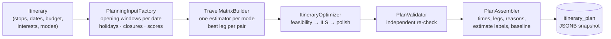

# Itinerary optimization / 旅程最適化アルゴリズム

The planner is a deterministic, explainable optimization engine — no machine learning and no paid
AI service. Given the same trip it always produces the same plan, and every decision can be traced
to a rule written down here. The code lives in the framework-free module
[`backend/optimizer`](../backend/optimizer) (ADR-0002); the application only translates catalogue
data into a `PlanningProblem` and the result back into a plan document.

## 1. The problem

A traveller picks places, marks some as **must-visit**, sets the trip dates, the hours they want to
be out each day, a maximum number of visits per day, a total budget in yen, interests and the travel
modes they accept (walk, transit, taxi). Each day starts and ends at their base location (hotel).

The engine has to choose **which** places to visit, on **which day**, in **which order** and at
**what time**, such that:

| Hard constraint | Detail |
| --- | --- |
| Opening hours | A visit must fit entirely inside one opening window on that date (lunch breaks split the day into two windows). Weekly hours, one-off closures and the Japanese holiday rule are resolved per date first (§3). |
| Daily time window | Leave the base no earlier than the day's start, be back no later than its end. |
| Visits per day | At most `maxVisitsPerDay`. |
| Budget | Admissions plus transport fares over the whole trip ≤ budget. |
| Must-visits | A plan that cannot fit every must-visit is reported as infeasible, with the reason. |

Among all feasible plans it prefers, **lexicographically** (`Objective`):

1. more must-visits scheduled,
2. a higher total preference score (§4),
3. fewer travel minutes,
4. lower total cost.

A lexicographic order needs no hand-tuned weights, and each comparison can be explained in one
sentence: "this plan fits all your must-sees; among those it keeps the most of your places; among
those it travels least."

In the literature this is the **Team Orienteering Problem with Time Windows** (TOPTW, one "team
member" per day) with a knapsack-style budget, also called the multi-day Tourist Trip Design Problem.
It is NP-hard (it generalises the orienteering problem), so exact search is out of reach for 50
places over 14 days, and the engine uses an established metaheuristic instead (§5), checked against
an exact solver on small instances (§7).

## 2. Pipeline



For an *Optimize* request `PlanningService` also runs `KEEP_ORDER` (the traveller's own order) as a
baseline, so the response can say "the optimized plan fits 3 more places and saves 40 minutes of
travel". The plan itself is re-checked by the independent `PlanValidator` before it is stored; an
invalid plan is logged and refused (HTTP 500) rather than shown. The baseline only feeds the
comparison numbers.

## 3. From catalogue data to time windows

`OpeningHoursResolver` turns a place's rules into concrete windows for each trip date:

- weekly hours per ISO day of week (several windows per day for lunch breaks);
- one-off closures (for example the New Year holidays);
- `OPEN_ON_HOLIDAY_CLOSE_NEXT_DAY`, the common rule for Japanese museums (月曜休館、祝日の場合は翌平日休館):
  a museum closed on Mondays opens when the Monday is a national holiday and closes on the next
  non-holiday weekday instead. The official Cabinet Office holiday list for 2026–2027 is seeded
  (V5 migration); for dates outside the seeded years the plan carries a warning instead of guessing.

The opening hours themselves are **sample data**, marked `SAMPLE_UNVERIFIED` and labelled as such in
the UI (ADR-0007).

## 4. Scores: what the traveller wants

`CandidateScoring` (application module) maps the traveller's choices to small integers:

| Candidate | Score |
| --- | --- |
| A place the traveller added | 1,000, +3 if it matches one of their interests |
| A suggested place (optional "fill free time") | 2, +3 if it matches an interest |
| A must-visit | as above; it is a hard constraint, so its score does not change the outcome |

1,000 is larger than everything a plan could gain by dropping one chosen place: the interest bonuses
of all other stops (50 × 3) plus the maximum number of suggestions (50 × 5). So a plan with more of
the traveller's own places always wins, and suggestions can only fill time that would otherwise be
idle. `CandidateScoringTest` checks the inequality and demonstrates it on a concrete morning.

## 5. The search

### 5.1 Feasibility pre-analysis — `FeasibilityAnalyzer`, `O(n × d × w)`

Each candidate is first checked **on its own**: could it be visited on day *k* if it were the only
place in the trip (travel there and back, opening windows, the day's hours, the budget)? Candidates
that fail on every day are removed from the search and get a precise reason (`CLOSED_ON_TRIP_DATES`,
`OUTSIDE_DAILY_HOURS`, `NO_ROUTE`, `TOO_FAR_FOR_DAY`, `OVER_BUDGET`). The others carry the set of days
worth trying, which prunes every later step.

### 5.2 Iterated Local Search — `IteratedLocalSearch`

The structure follows Vansteenwegen et al. (2009) for the TOPTW, with a GRASP-style randomised repair:

```text
s  = best of localSearch(greedyConstruction()), localSearch(travellersOwnOrder())
s* = s
repeat
    s' = localSearch(perturb(s), noisy insertions)    // drop a random segment of optional visits per
                                                      // day; 1 in 3 times also move one visit to another day
    if s' ≥ s:  s = s'                                // accept sideways moves to drift across plateaus
    if s' > s*: s* = s'
    after 40 iterations without a new best: s = s*    // restart from the best
until 400 iterations, or 160 without a new best
polish(s*)                                            // exact re-ordering of days with ≤ 7 visits, then descent
```

- **Construction** inserts must-visits first, hardest first (fewest feasible days, then least total
  opening time), then
  optional places by the multi-resource ratio `score² / (timeShare + costShare)`: the fraction of the
  remaining free time and of the remaining budget an insertion would consume. With an unlimited budget
  this reduces to the classic time-based ratio; with a tight budget it stops one expensive place from
  crowding out several cheaper ones.
- **Cheapest insertion** (`InsertionSearch`, `O(d × L²)` per candidate) chooses the day and position
  with the smallest increase of the day's completion time — which counts waiting as well as travel —
  then the smallest added travel, then the earliest day and position.
- **Local search** (`LocalSearch`) is a descent over neighbourhoods ordered by the objective level they
  improve, restarting from the top after every accepted move:
  1. insert a missing must-visit;
  2. repair a must-visit: make room by dropping one or two optional visits, or by moving another
     must-visit to a different day;
  3. insert an optional place (best ratio, above);
  4. replace a scheduled optional place by an unscheduled one that scores higher, or scores the same
     but saves travel or money;
  5. 2-opt and or-opt (chains of 1–3 visits) within a day;
  6. relocate and swap visits between days.

  Every accepted move strictly improves the lexicographic objective, which guarantees termination
  (20,000 moves is a safety net).
- **Starting from the traveller's own order** as well as from the greedy construction guarantees that
  *Optimize* is never worse than *Keep my order* — a property test checks it on 150 random trips.
- **Route evaluation** (`RouteEvaluator`, `O(L)`) simulates a day forward in time: travel, wait if
  early, visit, continue; it is the single source of truth for feasibility during the search.

### 5.3 Determinism and bounds

The random number generators are seeded (`SolverSettings.DEFAULT`, seed 20261118), the search is
bounded by iteration counts rather than by time, and every loop iterates in index order, so identical
input yields an identical plan (tested). A 3-second wall-clock cap only protects against pathological
input; if it triggers, the plan is still valid and the solver statistics in the response say so.

### 5.4 Strategies

| Strategy | Meaning |
| --- | --- |
| `OPTIMIZE` | The search above. |
| `KEEP_ORDER` | The traveller's list as given: append each place to the current day, move to the next day when it no longer fits, never reorder or go back. Used as the baseline and for travellers who want exactly their order. |
| `EXACT` | Exhaustive reference solver for ≤ 8 places and ≤ 3 days, used by tests and the quality study. Not exposed over HTTP (tested). |

## 6. Travel times and fares

Travel estimates are pluggable (`TravelEstimator`, one per mode) so that a real provider can replace
the sample model without touching the search. The solver works on one pre-computed matrix with the
best leg per ordered pair of locations.

**Mode choice** (`ModeChoicePolicy`). Legs of the allowed modes are compared by generalised cost,
`minutes + fare / ¥30 per minute` — money is converted into time with a "value of time" of ¥1,800 per
hour, so a ¥1,500 taxi must save 50 minutes to beat a free walk. Walks of up to 12 minutes are always
offered, even if walking is not selected (nobody takes a train for 400 m).

**Transit** (`TransitNetworkEstimator`). A line-expanded graph of the sample network (about 57
stations, 25 lines including the Yamanote and Osaka Loop lines):

- one concourse node per station and one platform node per (line, stop);
- boarding edges weighted with the expected wait of the line type, alighting edges with 1 minute — a
  transfer is "alight + board" and pays the waiting penalty without special-case code;
- riding edges `distance × 1.15 ÷ scheduled speed`; walking transfers between stations closer than
  500 m (station complexes);
- door-to-door: up to 3 stations within 1.2 km of each end, `min(walk + ride + walk)` with at least
  one ride. One Dijkstra run per distinct access station fills the whole matrix
  (`O(n·k · (V + E) log V)`), using an indexed binary heap over a CSR graph.

| Line type | Scheduled speed | Wait per boarding | Fare per boarding |
| --- | --- | --- | --- |
| Subway | 30 km/h | 3 min | ¥180 + ¥12/km |
| Urban rail | 33 km/h | 3 min | ¥150 + ¥12/km |
| Regional rail | 55 km/h | 5 min | ¥170 + ¥15/km |
| Shinkansen | 210 km/h | 8 min | ¥3,000 + ¥26/km |

**Walking and taxi** (`DistanceModel`). 75 m/min with a 1.25 street-detour factor, at most 7 km.
Taxi: 1.35 detour, 20 km/h for the first 10 km and 45 km/h beyond, 5 minutes pick-up, about ¥500 for
the first km and ¥400 per km after that.

These numbers are **round assumptions, not timetables or official fares**. Every leg carries its
source (`SAMPLE_TRANSIT_NETWORK`, `DISTANCE_MODEL`) and is shown as an estimate. When a place has no
station within walking distance and the traveller allows only transit, the engine reports `NO_ROUTE`
instead of inventing a connection (scenario test `MissingTransitData`; Kinkaku-ji in the API test).

## 7. Verification

| Check | What it proves |
| --- | --- |
| `PlanValidator` | An independent checker that re-derives every time and total from the problem using none of the solver's code. It runs in the property tests and in the application before a plan is stored or shown. |
| Property tests (`OptimizerPropertyTest`) | 600 random trips never violate a hard constraint; on 400 small trips the heuristic reaches the exact optimum in at least 95 % of cases and never beats it; identical input gives identical plans; *Optimize* is never worse than *Keep my order* (150 trips). |
| Scenario tests (`ItineraryOptimizerScenarioTest`) | Impossible itineraries (must-visit closed on every trip day, open only outside the traveller's hours, visit longer than the opening window, too far for a day, over budget, conflicting must-visits); opening hours (closed on day 1 → visited on day 2, lunch breaks); priorities; route quality; missing transit data (no route → allowing taxis resolves it). |
| Exhaustive solver | Exact for any travel matrix: no pruning relies on the triangle inequality, which estimated matrices need not satisfy. `O(d · n! + (d+1)^n)`, hence the limits. |
| Integration tests (`PlanningApiIT`) | The real stack on PostgreSQL: holiday rule moving a museum's closing day, regular Monday closure, missing transit data, suggestions, stale plans, exports. |
| Quality study | 958 / 1,000 random instances at the exact optimum, 0 invalid plans; details in [benchmarks.md](benchmarks.md). |

## 8. Complexity summary

| Step | Cost |
| --- | --- |
| Opening windows | `O(n × d)` |
| Travel matrix (transit) | `O(n·k · (V + E) log V)` Dijkstra runs, `k ≤ 3` |
| Feasibility analysis | `O(n × d × w)` |
| Route evaluation | `O(L)` per day |
| Cheapest insertion | `O(d × L²)` per candidate, each position evaluated in `O(L)` |
| Local search | bounded by moves (each strictly improves the objective) |
| ILS | ≤ 400 iterations, early stop after 160 without improvement, 3 s cap |
| Polish | `L!` permutations for days with `L ≤ 7` (≤ 5,040) |

*n* candidates, *d* days, *w* windows per day, *L* visits per day (≤ 12).
Measured runtimes are in [benchmarks.md](benchmarks.md): milliseconds for typical trips, about 1–2 s
for the maximum size the API accepts.

## 9. Limitations

- **Mode choice is fixed per pair** before the search, so it does not react to the remaining budget
  (a cheaper but slower mode could sometimes fit one more place). Choosing it up front keeps the inner
  loop to an array lookup.
- **No day balancing**: the objective does not prefer evenly filled days, so a short trip may leave
  the last day empty when everything fits earlier.
- **Waiting is allowed**: a plan may start with waiting for a place to open; it is shown as waiting
  time, not hidden.
- **Must-visit exchange is missing**: when more must-visits are requested than can fit, the plan keeps
  the maximum number but not necessarily the best-scoring ones (see the quality study).
- **No timetables or traffic**: transit waits are frequency-based averages, taxis use fixed speeds.
- The catalogue, opening hours and fares are **sample data** for demonstration.

The full list, with impact and mitigation, is in [known-limitations.md](known-limitations.md).

### References

- P. Vansteenwegen, W. Souffriau, G. Vanden Berghe, D. Van Oudheusden (2009). Iterated local search
  for the team orienteering problem with time windows. *Computers & Operations Research* 36(12).
- H. R. Lourenço, O. C. Martin, T. Stützle (2003). Iterated Local Search. In *Handbook of
  Metaheuristics*.
- P. Vansteenwegen, D. Van Oudheusden (2007). The Mobile Tourist Guide: An OR Opportunity.
  *OR Insight* 20(3).
