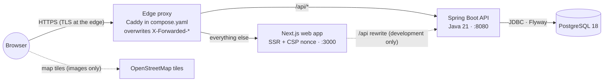
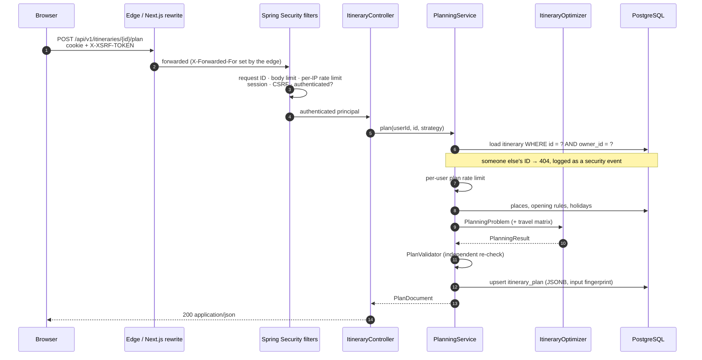

# Architecture / アーキテクチャ

A **modular monolith** (ADR-0001): one Spring Boot API with clear internal boundaries, one Next.js
web app, one PostgreSQL database. The optimization engine is a separate, framework-free Maven module
(ADR-0002). Splitting into microservices would add network failure modes, distributed transactions
and deployment overhead without any benefit at this scale; the module boundaries keep that option
open.

## 1. System context and deployment



- **One origin for the browser.** Pages and `/api/*` are served from the same origin, so the session
  cookie is first-party, CSRF protection is simple and the API needs no CORS (ADR-0004).
- **The edge proxy is the only public entry point** (ADR-0010). It routes `/api/*` straight to the API,
  everything else to Next.js, and replaces any client-supplied `X-Forwarded-*` headers. The API trusts
  those headers only from private-network peers, so its per-IP rate limits see real client addresses.
  During development, Next.js's `/api` rewrite plays the edge's role.
- **The database is on an internal network** with no route to the internet (compose `data` network).
- **Map tiles** are the only third-party requests; they are images loaded by the browser, allowed by
  the CSP's `img-src` and disclosed in the threat model (privacy).

## 2. Backend modules

```text
backend/
├── optimizer/    Framework-free engine: graph algorithms, travel estimation, TOPTW solver, validator.
│                 Depends on the JDK only (enforced by ArchUnit). Coverage gate 90 % lines / 80 % branches.
├── app/          Spring Boot API: HTTP, security, persistence, catalogue, itineraries, planning.
│                 Depends on optimizer. Coverage gate 85 % lines / 65 % branches.
└── benchmarks/   JMH benchmarks and the solution-quality study. Not shipped.
```

Inside `app`, code is organised **by feature**, each with the same layers:

```text
dev.tabiji
├── account     api · application · domain · infrastructure   registration, login, password policy
├── catalog     api · application · domain · infrastructure   areas, places, opening hours, holidays
├── itinerary   api · application · domain · infrastructure   trips, planning, exports
├── transport   sample transit network loader (adapter for the optimizer's TravelEstimator port)
├── admin       api · application                             aggregate statistics (ADMIN only)
├── security    filter chains, CSRF, sessions, rate limiting
├── shared      errors (RFC 9457), request IDs, body limits, OpenAPI, i18n text, clock
└── demo        optional demo account for local runs
```

| Layer | Responsibility | May depend on |
| --- | --- | --- |
| `api` | HTTP: controllers, request/response DTOs, validation annotations, status codes, ETags | application, domain |
| `application` | Use cases and transactions: ownership checks, orchestration, mapping to the optimizer | domain, infrastructure, optimizer |
| `domain` | Entities and invariants (`ItineraryDraft` validation, opening-hours rules) | nothing outside the domain |
| `infrastructure` | Spring Data repositories, specifications | domain |

`ArchitectureTest` (ArchUnit) enforces the important rules on every build: controllers live in `api`
packages; the `api` layer never touches repositories; the domain does not depend on outer layers;
feature packages are free of cycles; the optimizer imports nothing from Spring, Jakarta or Hibernate;
no field injection, no `System.out`, no `java.util.logging`, no generic exceptions.

### Ports and adapters for travel data

The optimizer defines the port `TravelEstimator` (one per travel mode). Two adapters exist:
`DistanceModelEstimator` (walking and taxi from straight-line distance) and `TransitNetworkEstimator`
(Dijkstra on a line-expanded rail graph, loaded from `transit/sample-network.json` by
`SampleTransitNetworkLoader`). A real provider — for example a GTFS feed or a commercial routing API —
would be a third adapter registered in `TransportConfiguration`; the solver and the API would not
change. Map rendering is likewise isolated in the frontend's `TripMap` component.

## 3. Request flow: generating a plan



## 4. Frontend

```text
frontend/src/
├── app/[lang]/          App Router pages per locale: landing, login, register, trips, editor, print
├── components/          ui primitives · auth · trips · itinerary editor · plan panel · map
├── i18n/                typed message catalogues (en, ja), formatting (yen, minutes, dates), provider
├── lib/api/             generated OpenAPI types, typed client with CSRF middleware, TanStack Query hooks
└── proxy.ts             locale redirect + per-request CSP nonce (Next.js 16 "proxy", formerly middleware)
```

- **Rendering.** Pages render on the server per request (the CSP nonce must be fresh, so Cache
  Components and static prerendering are off — ADR-0009). Data is fetched in the browser with
  TanStack Query against the same-origin API; no secrets or tokens are ever held in JavaScript.
- **Contract.** `src/lib/api/schema.d.ts` is generated from `docs/api/openapi.json` by
  `openapi-typescript`; the backend's `OpenApiContractIT` fails when the API and the committed contract
  drift apart, and CI fails when the generated types are out of date.
- **i18n.** A small dependency-free layer (ADR-0009): `/en/...` and `/ja/...` routes, the Japanese
  catalogue is type-checked against the English one, plural rules come from `Intl.PluralRules`, and
  yen, durations and dates are formatted with `Intl`.
- **Maps.** Leaflet with OpenStreetMap tiles, loaded client-side only. Leaflet's `divIcon` writes its
  `html` with `innerHTML`, so markers contain only numbers produced by the app; place names appear in
  React-rendered popups, which React escapes.

## 5. Data

PostgreSQL 18, schema owned by Flyway migrations (`V1`–`V5`), validated by Hibernate at start-up
(`ddl-auto=validate`). Generated plans are stored as immutable JSONB snapshots with an input
fingerprint (ADR-0006), so a plan never changes silently when the catalogue changes, and the UI can
say when a trip was edited after its plan was made. Details and the ER diagram: [database.md](database.md).

## 6. Cross-cutting concerns

| Concern | Where |
| --- | --- |
| Authentication, sessions, CSRF | `security.SecurityConfiguration`, `SessionLogin`, `SpaCsrfTokenRequestHandler` — ADR-0003 |
| Authorisation (ownership, roles) | `ItineraryService.load` (owner-scoped queries, 404 for foreign IDs), `@PreAuthorize` for admin |
| Validation | Bean Validation on DTOs, domain invariants in `ItineraryDraft`, database CHECK constraints |
| Errors | `GlobalExceptionHandler` → RFC 9457 problem details with a stable `code` and the request ID |
| Rate limiting | `security.ratelimit` (Bucket4j token buckets in bounded Caffeine caches) |
| Observability | Request ID filter (MDC + `X-Request-Id`), security event logger `security`, ECS JSON logs in `prod`, health probes |
| Configuration | `application.yml` holds production-safe defaults; profiles `local`/`test`/`prod`; secrets only from environment variables |

More detail: [api.md](api.md) · [security-controls.md](security-controls.md) ·
[algorithm.md](algorithm.md) · [deployment.md](deployment.md) · [ADRs](adr/README.md)
