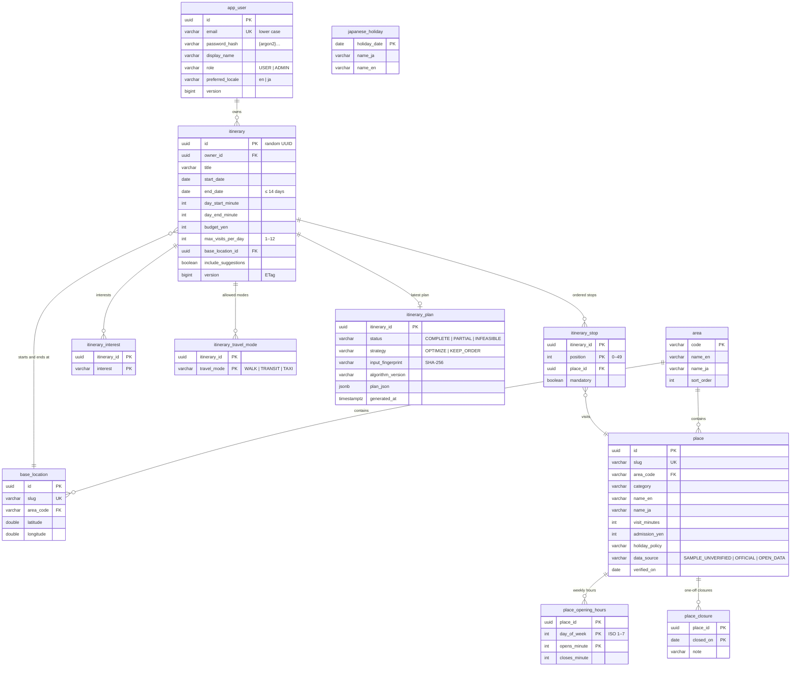

# Database / データベース

PostgreSQL 18. The schema is owned by Flyway migrations in
[`backend/app/src/main/resources/db/migration`](../backend/app/src/main/resources/db/migration);
Hibernate only validates it at start-up (`spring.jpa.hibernate.ddl-auto=validate`), so the database
can never drift from the migrations unnoticed. Tests run the same migrations on a real PostgreSQL 18
(ADR-0005).

| Migration | Content |
| --- | --- |
| `V1__create_accounts.sql` | `app_user` |
| `V2__create_catalog.sql` | `area`, `base_location`, `place`, `place_opening_hours`, `place_closure`, `japanese_holiday` |
| `V3__create_itineraries.sql` | `itinerary`, `itinerary_interest`, `itinerary_travel_mode`, `itinerary_stop`, `itinerary_plan` |
| `V4__seed_sample_catalog.sql` | 5 areas, 11 base locations, 44 sample places with weekly hours and year-end closures (`SAMPLE_UNVERIFIED`) |
| `V5__seed_japanese_holidays.sql` | The 35 national holidays of 2026–2027 published by the Cabinet Office |

## ER diagram

`japanese_holiday` is a standalone reference table, joined by date when opening hours are resolved.

## Design notes

**Ownership is a column, and every query uses it.** All itinerary access for a user request goes
through `ItineraryService.load`, which queries `WHERE id = ? AND owner_id = ?`. Only when that finds
nothing does it check whether the ID exists at all — not to return it, but to log a security event for
an attempt on someone else's itinerary. Foreign and unknown IDs are both answered with 404, so the API
is not an existence oracle. IDs are random UUIDs, not sequences.

**Constraints in the database as well as in code.** Lower-case e-mail, allowed roles, locales,
categories and travel modes, the 14-day limit, the daily window (at least one hour), the budget range,
1–12 visits per day, opening minutes within 0–1440, coordinates inside Japan's bounding box. Bean
Validation and the domain model reject bad input first, with precise error codes; the CHECK
constraints guarantee that no code path — including a future one — can store an invalid row.

**Stops are an ordered list.** `(itinerary_id, position)` is the primary key. A place may appear only
once per itinerary: `UNIQUE (itinerary_id, place_id)` is `DEFERRABLE INITIALLY DEFERRED`, so
reordering the list inside one transaction does not trip over temporary duplicates.

**Plans are immutable snapshots** (ADR-0006). `plan_json` stores the whole plan document as shown to
the traveller — times, legs, estimate labels, reasons, notices — together with the algorithm version
and a SHA-256 fingerprint of the planning-relevant inputs. If the itinerary changes afterwards, the
fingerprints differ and the API marks the plan `stale`. Changing catalogue data or improving the
algorithm never rewrites a plan someone has already seen. Only the latest plan per itinerary is kept.

**Optimistic locking.** `itinerary.version` is exposed as an `ETag`; updates must send `If-Match` and
get `412 Precondition Failed` on a stale version (`428` when the header is missing), so two browser
tabs cannot overwrite each other silently. Child collections are excluded from version bumps so that
creating an itinerary does not immediately increment its version.

**Opening hours are rules, not dates.** Weekly hours per ISO weekday (several rows for lunch breaks),
one-off closures and a holiday policy per place. `OpeningHoursResolver` turns them into windows for
the trip dates; `OPEN_ON_HOLIDAY_CLOSE_NEXT_DAY` encodes the common museum rule 月曜休館（祝日の場合は翌平日）.

**Provenance on every place.** `data_source` and `verified_on` travel with the data to the UI, which
labels sample entries (ADR-0007). The seeded catalogue is `SAMPLE_UNVERIFIED` throughout.

**Deletion cascades.** Deleting an itinerary removes its stops, interests, modes and plan
(`ON DELETE CASCADE`); the API exposes this. Account deletion has no endpoint yet (roadmap), but the
foreign key already cascades to the account's itineraries. Catalogue rows referenced by stops cannot
be deleted while in use (no cascade on `itinerary_stop.place_id`).

## Not in the database

- Sessions are in memory (Spring Session JDBC is the documented path to multiple instances).
- Rate-limit buckets are in memory (bounded Caffeine caches).
- The sample transit network is a JSON resource loaded at start-up (`transit/sample-network.json`).
