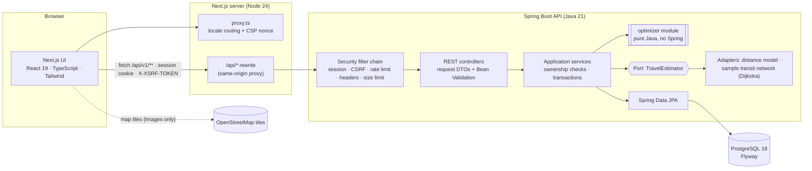
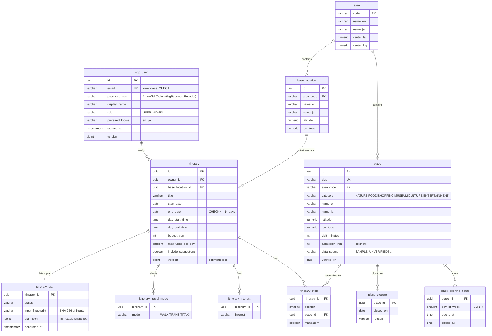

# Tabiji 旅路 — Project Plan

> Japan Intelligent Travel Planner. This document was written **before implementation** and records
> the starting point, the proposed architecture, the MVP boundary, the database design, the main
> security risks, the milestone roadmap and measurable acceptance criteria. Later documents
> (`docs/architecture.md`, `docs/threat-model.md`, ADRs) refine it; if they disagree, they win and
> this file notes the change.

## Status (2026-11-18)

Milestones M0–M6 are implemented and committed locally; nothing has been pushed.

**Changes against this plan**

- Internationalisation uses a small dependency-free layer instead of next-intl, TypeScript is 5.9.3
  instead of 6.0, and Cache Components are off because every page carries a CSP nonce (ADR-0009).
- An edge proxy (Caddy) is the only public entry point of the compose stack, because Next.js forwards
  `X-Forwarded-For` unchanged (ADR-0010). The compose file is `compose.yaml`.
- Dependency scanning uses OSV-Scanner instead of Trivy, plus `npm audit`, CodeQL and gitleaks.

**Acceptance criteria (§9)**

| Criterion | Result |
| --- | --- |
| `./mvnw verify` | Passes: 74 optimizer, 25 unit and 58 integration tests; Spotless, SpotBugs (0 findings), ArchUnit, JaCoCo gates |
| `npm run verify` | Passes: Prettier, ESLint (0 warnings), `tsc`, 43 Vitest tests, `next build` |
| Hard constraints never violated | 0 violations: 600 random instances in the build, 1,000 in the quality study |
| Determinism | Tested: identical input gives an identical plan (solver timing statistics aside) |
| Quality ≥ 95 % optimal | 95.8 % of 1,000 instances (study); ≥ 95 % enforced on 400 in the build |
| 60 places × 7 days well under 1 s | 468 ± 51 ms (JMH, laptop) — see `docs/benchmarks.md` |
| Edge-case tests | Present (scenario and API tests) |
| Security regression tests | Present (`OwnershipSecurityIT`, `AuthFlowIT`, `WebSecurityIT`) |
| E2E in `en` and `ja` with axe | 5 journeys pass against a production build; the Japanese journey plans but does not export, and map markers are not asserted |
| Every number in the docs from a run | Yes; dates and machines are stated |
| Runs without Docker | Yes, on the development machine (Windows 11) |
| Runs with `docker compose up` | **Not verified**: no Docker on the development machine; the CI job `e2e` covers it once the repository is pushed |

## 1. Repository review (starting point)

| Item | Finding | Consequence |
| --- | --- | --- |
| Workspace | `Other Apps/` holds two unrelated projects (`SupplyHub`, Python/Flask; `spend-check`, TypeScript). No travel-planner code exists. | Greenfield project in a new folder `japan-travel-planner/`. Nothing to migrate. |
| Version control | No Git repository. Global Git identity is configured. | `git init` inside the new folder; one commit per milestone; **no remote, no push** without approval. |
| Java | Not installed. Eclipse Temurin **21.0.13** (LTS) downloaded portable to `%USERPROFILE%\.jdks` (SHA-256 verified). | Backend builds via the Maven Wrapper with `JAVA_HOME` pointing at the portable JDK. |
| Node.js | v24.22.1 / npm 11.19.1 | Frontend uses npm workspaces-free single package; Node 24 LTS in CI and Docker. |
| Docker / PostgreSQL | **Neither installed**, no WSL. | Integration tests must not depend on Docker being present: Testcontainers when Docker is available (CI), **embedded PostgreSQL binaries** otherwise. `docker-compose.yml` is provided but cannot be executed on this machine. |
| Disk / network | 64 GB free; Maven Central, npm registry reachable. | No constraint. |

Versions were checked against Maven Central / npm on 2026-11-18 (not from memory):
Spring Boot **4.1.2** (Spring Framework 7.0, Spring Security 7.1, Hibernate 7.4, Flyway 12.4, Jackson 3.1,
JUnit Jupiter 6.0, Testcontainers 2.0), springdoc-openapi 3.2.0, Next.js **16.4**, React 19.3,
next-intl 4.15, Tailwind CSS 4.3, Playwright 1.65, Vitest 5.1. Spring Boot 3.5 is past its open-source
support window, so 4.x is the only responsible choice for a new project.

## 2. Product summary

A bilingual (日本語 / English) web application in which a traveller

1. chooses Japanese destinations from a curated catalogue (Tokyo, Kamakura, Kyoto, Osaka, Nara in the MVP),
2. sets dates, daily time window, budget in yen, interests, allowed transport modes and pace,
3. adds / removes / reorders stops and marks some as **must-visit**,
4. presses **Optimize** and gets a day-by-day schedule that respects opening hours, travel times, budget
   and daily limits — with an explanation for every place that could not be scheduled,
5. sees the plan on a map, with estimated travel time and cost for every leg (always labelled as estimates),
6. saves, edits, duplicates and exports (iCalendar `.ics`, JSON, printable page) the itinerary.

## 3. Architecture

### 3.1 Style: modular monolith, three deployables



Why a modular monolith and not microservices: one team, one database, strong consistency needs
(itinerary + plan), and no independent scaling requirement. Module boundaries are enforced at build
time instead (Maven modules + ArchUnit), which gives most of the design benefit without network hops,
distributed transactions or extra operations cost. See ADR-0001.

### 3.2 Backend (Maven multi-module)

| Module | Responsibility | Depends on |
| --- | --- | --- |
| `backend/optimizer` | Planning-problem model, shortest paths (Dijkstra), travel matrix, schedule evaluation, construction heuristic, local search, iterated local search, infeasibility diagnostics, exact reference solver. **No Spring, no JPA, no I/O.** | JDK only |
| `backend/app` | Spring Boot REST API, security, persistence, provider adapters, mapping between the persistence model and the optimizer model. | `optimizer` |
| `backend/benchmarks` | JMH micro-benchmarks and the solution-quality study (heuristic vs exact optimum). Not shipped. | `optimizer` |

Package layout inside `app` is **by feature, then by layer**:

```
dev.tabiji
├── shared/        error handling (RFC 9457 Problem Details), clock, web filters, OpenAPI config
├── security/      SecurityFilterChain, password hashing, rate limiting, current-user resolution
├── account/       api · application · domain · infrastructure   (registration, login, /me)
├── catalog/       api · application · domain · infrastructure   (areas, base locations, places, opening hours)
├── itinerary/     api · application · domain · infrastructure   (CRUD, duplicate, export, planning)
└── transport/     domain (TravelEstimator port) · infrastructure (distance model, transit network)
```

Rules (enforced by ArchUnit tests): controllers live in `..api..` and never touch repositories; domain
code never depends on `..api..`; constructor injection only; no `System.out`/`printStackTrace`.

Pragmatic choice on domain vs persistence model: itinerary and catalogue are CRUD-centred, so JPA
entities double as aggregates (avoids a mapping layer with no behaviour). The computation-heavy part —
the optimizer — has its **own** immutable model, and `PlanningService` acts as the anti-corruption layer
between the two. Dependency inversion is used where it pays off: travel-time providers are ports so a
real provider (NAVITIME, Ekispert, Google Routes, OSRM, GTFS/ODPT-based router) can replace the sample
adapters without touching the optimizer or the services.

### 3.3 Frontend

Next.js 16 App Router, TypeScript (strict), Tailwind CSS 4, next-intl (`/en/...`, `/ja/...`, locale
negotiated from `Accept-Language`), TanStack Query for server state, react-leaflet + OpenStreetMap tiles
for maps (no API key). The browser only ever talks to its own origin: Next.js rewrites `/api/*` to the
Spring API, so **no CORS is needed in normal operation**, cookies are first-party, and the API can stay
on a private network. API types are generated from the committed OpenAPI document
(`openapi-typescript`), and CI fails if the generated types drift from the backend contract.

### 3.4 Authentication and sessions (ADR-0003)

Server-side sessions (HttpOnly, SameSite=Lax, Secure outside local dev) instead of JWTs in browser
storage: a first-party browser app does not need bearer tokens, sessions can be revoked instantly, and
nothing readable by JavaScript can be stolen by XSS. Spring Security handles login via
`AuthenticationManager`; session ID is rotated on login (fixation), CSRF tokens use the SPA double-submit
pattern (`XSRF-TOKEN` cookie → `X-XSRF-TOKEN` header, BREACH-safe masking), passwords are hashed with
**Argon2id** via Spring Security's `DelegatingPasswordEncoder` (bcrypt hashes stay verifiable for
upgrades). No custom cryptography, no home-made token format.

## 4. Itinerary optimization approach (summary — full write-up in `docs/algorithm.md`)

The problem is a **multi-day Tourist Trip Design Problem**, modelled as a *Team Orienteering Problem with
Time Windows* (TOPTW) plus hard constraints: each trip day is a "route" that starts and ends at the
traveller's base, each place has a visit duration and per-date opening windows, must-visit places are
mandatory, total estimated cost must stay within budget, and each day has a visit limit. TOPTW is
NP-hard, so:

1. **Travel matrix** — door-to-door estimates between every pair of relevant locations for each allowed
   mode. Transit uses **Dijkstra** (binary heap, one-to-all, `O((V+E) log V)`) on a line-expanded sample
   rail graph (boarding/transfer penalties are edges); walking/taxi use a distance model. Per leg, the mode
   with the lowest *generalised cost* (minutes + yen ÷ value-of-time) is chosen. A\* is deliberately not
   used: we need one-to-many distances, where goal-directed search gives no benefit.
2. **Feasibility pre-analysis** — per place and day: closed? does the visit fit an opening window inside
   the day window? reachable from the base and back in time? affordable? Produces precise reasons.
3. **Construction** — must-visits first (hardest-to-place first), then optional places by the
   Vansteenwegen ratio `score² / added time`, cheapest feasible insertion over all days/positions.
4. **Local search** — 2-opt and or-opt within a day, relocate/swap between days, re-insertion of skipped
   places, replacement of low-score places by better unscheduled ones.
5. **Iterated Local Search** — deterministic, seeded perturbation (remove a segment of optional visits per
   day) + repair + local search; keeps the lexicographically best solution:
   `(must-visits scheduled ↓, preference score ↓, travel minutes ↑, cost ↑)`.
6. **Explanation** — status (`COMPLETE` / `PARTIAL` / `INFEASIBLE`), per-place reasons, actionable hints
   (extend the day, add a day, raise budget), and a comparison against the user's own order
   ("optimized saves 47 min of travel and fits 2 more places").

Quality is verified, not assumed: an exact reference solver (exhaustive enumeration over day assignments
with per-day permutation search) is compared against the heuristic on hundreds of seeded random small
instances, and JMH measures runtime for up to 60 candidates × 14 days.

**Data honesty rule:** no invented timetables, fares or opening hours are presented as facts. Catalogue
data is labelled `SAMPLE_UNVERIFIED`; every travel leg carries `estimated: true` and its data source;
the UI shows "≈ estimate" badges and "verify before travel" notices.

## 5. MVP scope

**In scope (MVP)**

- Accounts: register, login, logout, current user; Argon2id; session cookie; CSRF; rate-limited auth.
- Catalogue (read-only, public): areas, base locations (stations/hotel areas), ~40 sample places with
  bilingual names, categories, coordinates, typical visit duration, approximate admission, weekly opening
  hours and closure dates, provenance labels.
- Itineraries (owner-only): create, list (paged), read, update (optimistic locking), delete, duplicate;
  stops with add / remove / reorder / must-visit flag; preferences (dates ≤ 14 days, daily window, budget,
  interests, transport modes, visits per day, base location, "suggest places for free time").
- Planning: optimize or keep-my-order; persisted plan snapshot with input fingerprint → "plan is out of
  date" detection; explanations; estimates labelled.
- Export: iCalendar (`.ics`, RFC 5545 escaping), JSON, print-friendly page.
- UI: landing, auth, dashboard, editor with search/add/reorder, map with day-coloured routes, daily
  timeline, budget meter, unscheduled-place reasons, ja/en switch, loading/empty/error states.
- Quality: unit, integration (real PostgreSQL), security-regression, contract (OpenAPI drift), algorithm
  property tests, E2E (Playwright + axe accessibility scan), JMH benchmarks, SpotBugs + FindSecBugs,
  Spotless, ESLint, `tsc --noEmit`, dependency scanning, GitHub Actions.

**Out of scope (roadmap)** — real transit/timetable providers, multi-city base per night, lunch-break
constraints, sharing/collaboration, passkeys/MFA, OAuth (LINE/Google), email verification and password
reset, admin catalogue UI, offline/PWA, weather-aware planning, crowd/season data.

## 6. Database schema (PostgreSQL 18, Flyway)



Design notes: UUID keys (no enumerable IDs); every itinerary query is `WHERE id = ? AND owner_id = ?`;
CHECK constraints duplicate the most important validation rules (defence in depth); `(itinerary_id,
place_id)` uniqueness is `DEFERRABLE INITIALLY DEFERRED` so reordering inside one transaction cannot
trip it; index `(owner_id, updated_at DESC)` serves the dashboard; the plan is stored as **JSONB** because
it is an immutable, derived document always read whole — inputs stay normalised.

## 7. Main security risks (full STRIDE model in `docs/threat-model.md`)

| # | Risk | Primary controls |
| --- | --- | --- |
| R1 | Broken object-level authorization (reading/changing another user's trip — reveals when someone is away from home) | Owner-scoped queries, 404 for foreign IDs, UUIDs, BOLA regression tests on **every** itinerary endpoint |
| R2 | Credential stuffing / brute force | Argon2id, per-IP + per-account rate limits (429 + `Retry-After`), generic error messages, constant-time-ish user lookup (Spring's dummy-hash) |
| R3 | Session hijacking / fixation / CSRF | HttpOnly + SameSite + Secure cookies, ID rotation on login, idle timeout, CSRF tokens on all state-changing requests |
| R4 | XSS | React auto-escaping, no `dangerouslySetInnerHTML` (lint rule), React-rendered map popups (Leaflet string popups use `innerHTML`), nonce-based CSP |
| R5 | Injection (SQL, LIKE wildcards, ICS property injection, log forging) | JPA parameters, escaped `LIKE` patterns, RFC 5545 escaping, structured JSON logs |
| R6 | Mass assignment / privilege escalation | Request-specific DTO records, `FAIL_ON_UNKNOWN_PROPERTIES`, role never bindable |
| R7 | Resource exhaustion (optimizer CPU, large bodies, rate-limiter memory) | Input bounds (≤ 50 stops, ≤ 14 days), per-user optimize rate limit, iteration + time caps, 64 KB body limit, bounded caches, timeouts |
| R8 | Information leakage | RFC 9457 errors without stack traces, `Cache-Control: no-store`, secrets never logged, safe actuator exposure |
| R9 | Supply chain | Lockfiles, Dependabot, CodeQL, OSV/Trivy scan, `npm audit`, GitHub Actions pinned to commit SHAs, least-privilege workflow tokens |

## 8. Milestones

Each milestone ends with: tests + static checks run locally, a security review of the change, docs
updated, and one descriptive Git commit.

| Milestone | Deliverables |
| --- | --- |
| **M0 Plan & scaffold** | This plan, threat model draft, ADRs, repository skeleton, Maven wrapper, Git repo |
| **M1 Optimization engine** | `optimizer` module: model, Dijkstra, travel matrix, evaluator, construction, local search, ILS, diagnostics, exact solver; unit + property tests |
| **M2 API foundation** | Spring Boot app, Flyway schema + reference data, security chain, auth endpoints, Problem Details, OpenAPI, real-PostgreSQL integration-test harness |
| **M3 Itineraries & planning** | Catalogue API, itinerary CRUD/duplicate/export, planning service, transport adapters, BOLA / CSRF / mass-assignment / rate-limit / header regression tests, ArchUnit |
| **M4 Frontend** | Next.js app, i18n, auth, dashboard, editor, map, timeline, export, unit tests, generated API types |
| **M5 Delivery** | Playwright E2E + axe, GitHub Actions (build, test, scan, CodeQL), Dependabot, Dockerfiles, docker-compose |
| **M6 Portfolio docs** | README (en/ja) with interview section, algorithm + benchmark report, security controls, testing strategy, limitations, roadmap, screenshots |

## 9. Acceptance criteria (measurable)

| Area | Criterion |
| --- | --- |
| Build | `./mvnw verify` passes: compile with `-Xlint:all -Werror`, unit + integration tests, Spotless, SpotBugs/FindSecBugs, ArchUnit, JaCoCo thresholds |
| Build | `npm run verify` passes: Prettier, ESLint (0 warnings), `tsc --noEmit`, Vitest, `next build` |
| Optimizer correctness | Generated plans **never** violate a hard constraint (opening hours, day window, daily limit, budget, must-visit coverage when reported feasible) across ≥ 1,000 seeded random instances |
| Optimizer determinism | Identical input ⇒ byte-identical plan (tested) |
| Optimizer quality | On seeded small instances, heuristic objective equals the exact optimum in a documented share of cases (target ≥ 95 %); gap statistics published |
| Optimizer performance | JMH: 60 candidates × 7 days optimised in well under 1 s on the dev laptop (exact figures published) |
| Edge cases | Tests for impossible itineraries, closed attractions, missing transit data, conflicting must-visits, budget below must-visit cost |
| Security | Non-owners get 404 on GET/PUT/DELETE/duplicate/optimize/plan/export of foreign itineraries and DB state is unchanged; missing CSRF ⇒ 403; anonymous ⇒ 401; unknown JSON fields ⇒ 400; 6th rapid login ⇒ 429; security headers asserted; no stack traces in any error body |
| E2E | Register → create trip → add places → optimise → see schedule on map → export, in both `en` and `ja`; axe finds no serious/critical violations |
| Docs | Every documented feature exists; every number in the docs comes from an actual run |
| Run | Fresh clone + JDK 21 + Node 24 runs locally **without Docker** (embedded PostgreSQL) and **with Docker** (`docker compose up`) |
