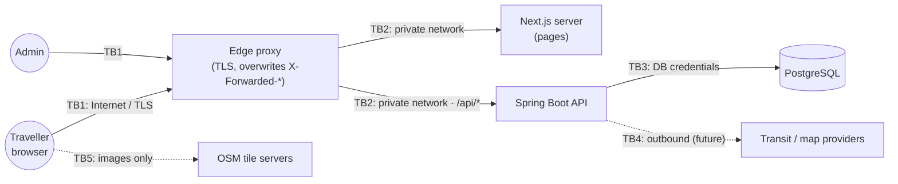

# Threat Model / 脅威モデル

Method: data-flow diagram → STRIDE per element → controls → residual risk. Reviewed at every
milestone; last review 2026-11-18 (M6). The "Status" column says whether a control is
**`tested`** (implemented and covered by an automated test that runs on every build),
**`implemented`** (in the code, verified by review or by hand, without a dedicated automated test),
**`CI`** (enforced by a GitHub workflow that is written but has not run yet, because nothing has been
pushed) or **`accepted`** (a residual risk, see §5). The control → code → test mapping is in
[security-controls.md](security-controls.md).

## 1. Assets

| Asset | Why it matters |
| --- | --- |
| Credentials (password hashes) | Account takeover; password reuse on other sites |
| Session identifiers, CSRF tokens | Equivalent to a logged-in user |
| Itineraries | Personal data: they reveal **when a person is away from home and where they will be** (stalking, burglary). Treated as confidential. |
| Catalogue data | Integrity: wrong opening hours or prices mislead travellers |
| Service availability | The optimizer is CPU-bound; one abusive client must not starve others |
| Third-party credentials (future providers) | Billing abuse, quota theft |

## 2. Data flow and trust boundaries

- **TB1** untrusted input enters; everything from the browser is attacker-controlled.
- **TB2** neither the web server nor the API is exposed publicly; the API still authenticates and
  authorises every request itself. Forwarded headers are trusted only from private-network peers,
  and the edge overwrites them (ADR-0010).
- **TB3** least-privilege DB user; schema changes only via Flyway; the compose database network has
  no internet access.
- **TB4** provider responses will be untrusted input (validated, size-limited, timed out). No
  outbound calls exist today.
- **TB5** the browser fetches tiles directly: OSM sees the user's IP and viewed area (privacy note).

## 3. STRIDE analysis

| ID | Element | Threat | Control | Status |
| --- | --- | --- | --- | --- |
| S1 | Login | Credential stuffing / online guessing | Per-IP (20/min) and per-account (5 per 15 min) token buckets, checked before the password is verified → 429 + `Retry-After`; Argon2id; one generic `INVALID_CREDENTIALS` answer | tested |
| S2 | Login | User enumeration through timing | Spring's `DaoAuthenticationProvider` hashes a dummy password for unknown users | implemented |
| S3 | Session | Session fixation | Session ID and CSRF token rotated on sign-in and registration | tested |
| S4 | Session | Cookie theft via XSS / network | `HttpOnly`, `Secure` + `__Host-` prefix (production), `SameSite=Lax`, 30-min idle timeout; HSTS at the edge | implemented (production cookie checked by hand on 2026-11-18) |
| S5 | Rate limiter | Forged `X-Forwarded-For` to escape per-IP limits (Next.js forwards the header unchanged) | Edge proxy overwrites forwarded headers and is the only public entry; API trusts them only from private peers (ADR-0010) | implemented (compose); deployment requirement |
| T1 | State-changing API | CSRF | Spring Security CSRF, SPA double submit, on every non-GET request including login, registration and logout | tested |
| T2 | Itinerary update | Mass assignment (`ownerId`, `role`, `version`) | Request-only DTO records; `FAIL_ON_UNKNOWN_PROPERTIES=true`; owner taken from the session only | tested |
| T3 | Search | SQL injection, `LIKE` wildcard injection | Bound parameters only; `%`/`_`/`\` escaped; no string-built SQL | tested |
| T4 | ICS export | Calendar property injection via CR/LF in titles | RFC 5545 TEXT escaping + line folding; control characters rejected in titles | tested |
| T5 | Concurrent edits | Lost updates | Version as `ETag`; `If-Match` required → `412` on a stale version, `428` without it | tested |
| T6 | Plans | Tampered or invalid plan shown as valid | Independent `PlanValidator` before storage; JSONB snapshot with input fingerprint and algorithm version | tested |
| R1 | Security events | Repudiation / no forensic trail | `security` logger: sign-in success and failure, registration, denied access to foreign itineraries, CSRF and access denials, with request ID; e-mails only as short hashes; no secrets | implemented |
| I1 | Itinerary endpoints | **BOLA / IDOR** | Owner-scoped loading for every endpoint; foreign IDs → 404 (no existence oracle); random UUIDs | tested |
| I2 | Error responses | Stack traces / SQL in errors | RFC 9457 problem details with stable codes; `include-stacktrace=never`; catch-all handler with request ID | tested |
| I3 | Caches / proxies | Personal data cached | `Cache-Control: no-store` on API responses | tested |
| I4 | Logs | Secrets / PII in logs | Passwords, cookies, tokens never logged; DTOs hide passwords in `toString` | implemented |
| I5 | Actuator / API docs | Internal details exposed | Only `health` (no details) and `info`; Swagger UI and OpenAPI disabled outside `local`/`test` | tested (actuator); production docs checked by hand |
| I6 | Registration | Account enumeration ("email already registered") | Per-IP registration limit (10/hour) | accepted (§5) |
| D1 | Optimizer | CPU exhaustion | ≤ 50 stops, ≤ 14 days, ≤ 12 visits/day; iteration caps + 3 s wall-clock cap; exact solver not reachable over HTTP; per-user limit of 12 plans/min | tested (input limits, exact solver), implemented (plan rate limit) |
| D2 | Any endpoint | Large / slow bodies | 64 KB request body limit (413) before parsing, header and form size limits, connection and query timeouts | tested (body limit) |
| D3 | Rate limiter | Memory exhaustion by many keys | Caffeine caches bounded to 100,000 keys, 2-hour idle expiry | implemented |
| D4 | Login | Argon2 cost amplification | Login rate limits applied **before** hashing | tested |
| D5 | Login | Lock-out of a victim: an attacker spends the victim's per-account budget | Budget is short (15 min) and per instance | accepted (§5) |
| E1 | Roles | Becoming ADMIN | Role is not part of any request DTO; admin routes need `ROLE_ADMIN` in the filter chain and in method security | tested |
| E2 | Frontend | Script injection | React escaping; ESLint bans `dangerouslySetInnerHTML` and `innerHTML`; nonce-based CSP with `'strict-dynamic'`; map markers contain only app-generated numbers | tested (CSP unit + E2E), lint |
| E3 | Build pipeline | Supply-chain compromise | Lockfiles, `npm ci` without install scripts, Maven wrapper checksum, actions pinned to SHAs, images pinned by digest, `permissions: contents: read`, Dependabot with cooldown, CodeQL, OSV-Scanner, `npm audit`, gitleaks, SBOM | CI (`npm audit`: 0 runtime vulnerabilities, run locally 2026-11-18) |

## 4. Security requirements traceability

Each control above is mapped to code and to the test that proves it in
[security-controls.md](security-controls.md).

## 5. Residual risks (accepted for the MVP, with reasons)

| Risk | Why accepted / mitigation path |
| --- | --- |
| Registration reveals whether an e-mail is registered | Without e-mail verification there is no enumeration-safe sign-up UX. Rate limiting reduces bulk probing. Fix: e-mail verification flow (roadmap). |
| Per-account login limit can lock a user out for 15 minutes | Anyone who knows an e-mail address can spend its 5 attempts. Accepted because the window is short and it protects against password guessing. Fix: key the bucket on (account, client), add exponential back-off or a proof-of-work/CAPTCHA step after failures. |
| No MFA / passkeys | Out of MVP scope. Spring Security 7 supports WebAuthn passkeys — roadmap item. |
| Per-instance rate limiting | Buckets are in memory; with N instances the effective limit is N×. Fix: Bucket4j with a shared store (PostgreSQL/Redis) when scaling out. |
| Sessions are in memory | Restart signs users out; no horizontal scaling. Fix: Spring Session JDBC. |
| `X-Forwarded-For` trust | Correct only when the edge overwrites the header and is the only entry point (ADR-0010, [deployment.md](deployment.md)). A deployment that exposes Next.js directly weakens per-IP limits; per-account and per-user limits still hold. |
| OSM tile requests expose IP + viewed area to a third party | Disclosed here; fix: self-hosted tiles or a privacy-respecting tile proxy. |
| Sample catalogue data may be outdated | Labelled `SAMPLE_UNVERIFIED` everywhere; never presented as fact. |
| CI security workflows have not run yet | Written, pinned and validated as YAML, but unexecuted until the repository is pushed; until then the evidence is the local runs listed in [testing-strategy.md](testing-strategy.md). |
| Cookie attributes are not asserted by an automated test | MockMvc does not emit the servlet container's session cookie. Checked by hand against the production profile; fix: one test against the embedded server (`RANDOM_PORT`). |
