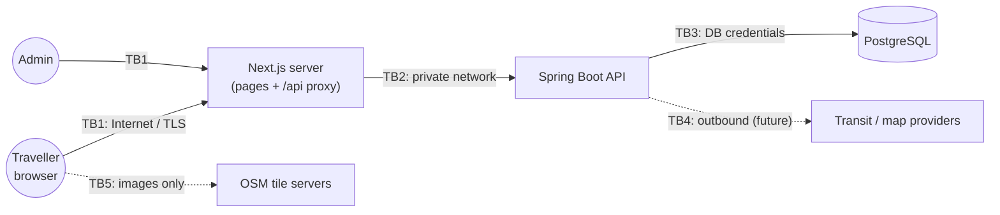

# Threat Model / 脅威モデル

Method: data-flow diagram → STRIDE per element → controls → residual risk. Reviewed at every milestone;
the "Status" column says whether a control is **implemented and covered by an automated test**
(`tested`), implemented without a dedicated test (`implemented`), or still planned (`planned`).

## 1. Assets

| Asset | Why it matters |
| --- | --- |
| Credentials (password hashes) | Account takeover; password reuse on other sites |
| Session identifiers, CSRF tokens | Equivalent to a logged-in user |
| Itineraries | Personal data: they reveal **when a person is away from home and where they will be** (stalking, burglary). Treated as confidential. |
| Catalogue data | Integrity: wrong opening hours or prices mislead travellers |
| Service availability | The optimizer is CPU-bound; one abusive client must not starve others |
| Third-party credentials (future providers) | Billing abuse, quota theft |

## 2. Data flow and trust boundaries

- **TB1** untrusted input enters; everything from the browser is attacker-controlled.
- **TB2** the API is not exposed publicly in the reference deployment; it still authenticates and
  authorises every request itself (no trust in the proxy).
- **TB3** least-privilege DB user; schema changes only via Flyway.
- **TB4** provider responses are untrusted input (validated, size-limited, timed out).
- **TB5** the browser fetches tiles directly: OSM sees the user's IP and viewed area (privacy note).

## 3. STRIDE analysis

| ID | Element | Threat | Control | Status |
| --- | --- | --- | --- | --- |
| S1 | Login | Credential stuffing / online guessing | Per-IP and per-email token buckets (Bucket4j) → 429 + `Retry-After`; Argon2id; generic "invalid email or password" | planned |
| S2 | Login | User enumeration through timing | Spring `DaoAuthenticationProvider` hashes a dummy password for unknown users | planned |
| S3 | Session | Session fixation | Session ID rotated on authentication (`ChangeSessionIdAuthenticationStrategy`) | planned |
| S4 | Session | Cookie theft via XSS / network | `HttpOnly`, `Secure` (non-local), `SameSite=Lax`, 30-min idle timeout, HSTS at the edge | planned |
| T1 | State-changing API | CSRF | Spring Security CSRF (SPA double-submit, masked tokens) on every non-GET request including login | planned |
| T2 | Itinerary update | Mass assignment (`ownerId`, `role`, `version` games) | Request-only DTO records; `FAIL_ON_UNKNOWN_PROPERTIES=true`; owner taken from the session only | planned |
| T3 | Search | SQL injection, `LIKE` wildcard injection | JPQL parameters only; `%`/`_`/`\` escaped in search terms; no string-built SQL | planned |
| T4 | ICS export | Calendar property injection via CR/LF in titles | RFC 5545 TEXT escaping + line folding; CR/LF stripped | planned |
| T5 | Concurrent edits | Lost updates | `@Version` optimistic locking → 409 | planned |
| R1 | Security events | Repudiation / no forensic trail | Structured logs for login success/failure, registration, deletion, denied access, with request ID; no secrets | planned |
| I1 | Itinerary endpoints | **BOLA / IDOR** | `findByIdAndOwnerId`; foreign IDs → 404 (no existence oracle); random UUIDs; tests for every endpoint | planned |
| I2 | Error responses | Stack traces / SQL in errors | RFC 9457 Problem Details with stable codes; `include-stacktrace=never`; catch-all handler with request ID | planned |
| I3 | Caches / proxies | Personal data cached | `Cache-Control: no-store` on API responses | planned |
| I4 | Logs | Secrets / PII in logs | Passwords, cookies, tokens never logged; emails logged only as a short hash in security events | planned |
| I5 | Actuator | Internal details exposed | Only `health` (no details) and `info` exposed; others disabled | planned |
| I6 | Registration | Account enumeration ("email already used") | Rate-limited; residual risk accepted (see §5) | planned |
| D1 | Optimizer | CPU exhaustion | ≤ 50 stops, ≤ 14 days, ≤ 12 visits/day, iteration cap + wall-clock cap, per-user rate limit on optimise | planned |
| D2 | Any endpoint | Large / slow bodies | 64 KB request body limit (413), header size limit, connection and query timeouts | planned |
| D3 | Rate limiter | Memory exhaustion by many keys | Bounded Caffeine caches with expiry | planned |
| D4 | Login | Argon2 memory cost amplification | Login rate limits applied **before** hashing | planned |
| E1 | Roles | Becoming ADMIN | Role not part of any request DTO; admin endpoints require `ROLE_ADMIN`; method security | planned |
| E2 | Frontend | Script injection | React escaping; ESLint bans `dangerouslySetInnerHTML`; nonce-based CSP with `strict-dynamic`; React-rendered map popups | planned |
| E3 | Build pipeline | Supply-chain compromise | Lockfiles, Dependabot, CodeQL, OSV/Trivy, `npm audit`, actions pinned to SHAs, `permissions: contents: read` | planned |

## 4. Security requirements traceability

Each control above is mapped to code and to the test that proves it in `docs/security-controls.md`
(written during M2–M5, when the controls exist).

## 5. Residual risks (accepted for the MVP, with reasons)

| Risk | Why accepted / mitigation path |
| --- | --- |
| Registration reveals whether an email is registered | Without email verification there is no enumeration-safe sign-up UX. Rate limiting reduces bulk probing. Fix: email verification flow (roadmap). |
| No MFA / passkeys | Out of MVP scope. Spring Security 7 supports WebAuthn passkeys — roadmap item. |
| Per-instance rate limiting | Buckets are in-memory; with N instances the effective limit is N×. Fix: Bucket4j with a shared store (PostgreSQL/Redis) when scaling out. |
| Sessions are in-memory | Restart logs users out; no horizontal scaling. Fix: Spring Session JDBC (schema already compatible with PostgreSQL). |
| OSM tile requests expose IP + viewed area to a third party | Disclosed in the UI; fix: self-hosted tiles or a privacy-respecting tile proxy. |
| Sample catalogue data may be outdated | Labelled `SAMPLE_UNVERIFIED` everywhere; never presented as fact. |
| `X-Forwarded-For` trust | Correct only when the API is reachable exclusively through the trusted proxy (documented deployment requirement). |
